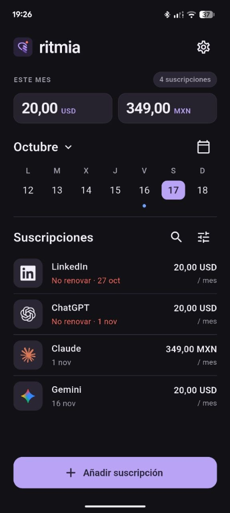
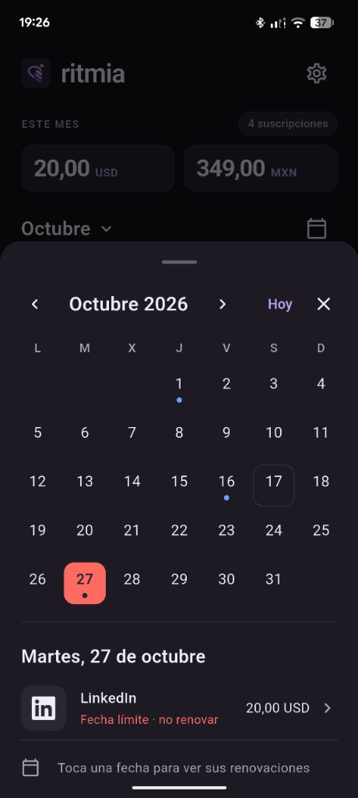

# Ritmia
**Tus suscripciones, a tu ritmo.**

App Flutter para Android, web e iOS con arquitectura por capas. Creada con el SDK local real: Flutter **3.47.7**, Dart **3.13.5**, Android SDK **36**. Proyecto independiente de Tumbo.

<p align="center">
  
  &nbsp;&nbsp;&nbsp;&nbsp;
  
</p>

## Descargar APK (Releases)
Puedes descargar directamente el APK precompilado desde los [Releases de GitHub](https://github.com/AndyCG03/ritmia/releases).

## Probar en Android
Es una versión local: no necesita cuenta y conserva los datos en el dispositivo de forma privada (local-first). Permite hasta cinco registros gratuitos en total.
Instala el APK en tu dispositivo y activa las notificaciones desde Ajustes para recibir los avisos 3 y 1 día antes de cada renovación.

## Ejecutar
```powershell
flutter pub get
flutter run -d edge
flutter run -d <android-device-id>
```

## Incluido
- Onboarding de tres pasos con Lotties originales y opción de reducir movimiento.
- Logo PNG generado con IA, iconos de launcher y paleta coherente.
- 214 marcas con buscador; SVG empaquetados, aproximadamente 214 KB en total.
- Suscripciones gratis/de pago; importes enteros, siete monedas, categorías, notas, color y logo personalizado.
- Renovaciones semanales, mensuales, trimestrales y anuales que respetan la fecha original.
- Calendario, resumen de cargos reales previstos por mes y divisa, búsqueda y filtros.
- Estados activa, pausada y archivada; enlace de gestión/cancelación con el proveedor.
- Fin del plan y fin de prueba, con anticipaciones de 1, 3, 7 o 14 días.
- Notificaciones locales Android/iOS: próximos 60 días, hasta 60 avisos; se actualizan al abrir/cambiar la app.
- Español e inglés, adaptación al sistema y elección persistente.
- Exportación CSV con protección frente a fórmulas de hojas de cálculo.
- Firebase Auth por correo/contraseña, verificación y recuperación, detrás del modo cloud.
- Firestore, Storage privado y Cloud Functions; límites transaccionales y comprobación de revisión.
- Cola de recordatorios por correo del servidor, preparada para la extensión Trigger Email.

## Dos modos
**Local** (por defecto) funciona sin Firebase y sin cuenta. Es el modo del APK inicial.

**Cloud** utiliza Auth, Firestore, Storage y funciones desplegadas. La app Android fue registrada en **ritmia-app**, número **725132962702**, paquete **app.ritmia.ritmia**. Su configuración está en `config/firebase.local.android.json`, excluida de Git.

```powershell
flutter run --dart-define-from-file=config/firebase.local.android.json
flutter build apk --debug --dart-define-from-file=config/firebase.local.android.json
```

Los datos locales y cloud son almacenes distintos; esta versión no migra registros automáticamente.

## Planes
Gratis: cinco registros, incluidas pausadas y archivadas. Pro: sin límite de registros. Calendario, recordatorios, logos, idiomas y exportación disponibles en ambos. Las compras todavía no están implementadas; no hay botón que simule un cobro ni un desbloqueo local.

**En esta versión Ritmia Pro está oculto.** La hoja de pago único, el aviso al llegar al límite y el interstitial "Pásate a Pro" siguen en el código (`lib/presentation/sheets/pro_sheet.dart`, `lib/services/billing_service.dart`) detrás del flag `RITMIA_PRO_ENABLED` (`lib/core/features.dart`). Para reactivarlos:

```powershell
flutter run --dart-define=RITMIA_PRO_ENABLED=true
```

## Comprobar
```powershell
flutter analyze
flutter test
npm.cmd --prefix functions ci
npm.cmd --prefix functions test
firebase.cmd emulators:exec --project demo-ritmia --only auth,firestore,functions,storage "node --test functions/lib/integration.test.js"
```
Para reproducir la compilación en esta PC, consulta `docs/ANDROID.md`: la red requiere certificados de Windows que Java no carga por defecto.

## Documentación
- [Arquitectura y decisiones](docs/ARCHITECTURE.md)
- [Configuración Firebase](docs/FIREBASE.md)
- [Android y pruebas en teléfono](docs/ANDROID.md)
- [Producto, planes y evolución](docs/PRODUCT.md)
- [Identidad y recursos](docs/BRAND.md)
- [Skill de ingeniería del proyecto](skills/subscription-engineering/SKILL.md)
