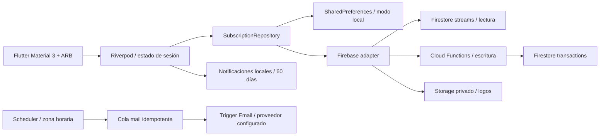

# Arquitectura
## Capas


## Patrones con propósito
- **Repository + ports/adapters**: dominio sin dependencias Flutter/Firebase; cambiar almacenamiento no cambia recurrencias.
- **Inyección con providers**: una instancia por sesión. Cerrar sesión invalida streams, imágenes y programación.
- **Unidirectional data flow**: vistas leen AsyncValue; comandos van al repositorio; los streams reflejan la persistencia.
- **Política de autorización**: Entitlement facilita UX; la transacción del servidor decide las altas realmente permitidas.
- **Concurrencia optimista**: cada registro tiene revision. Ediciones o borrados sobre una revisión antigua fallan con conflicto.
- **Transacciones serializables**: documento private/usage coordina altas y bajas. Siete altas simultáneas en Free dan cinco éxitos.
- **Idempotencia**: el correo utiliza SHA-256 de UID + evento + fecha + anticipación como ID de documento.
- **Value representation**: amountMinor entero y currency. Los importes de distintas monedas nunca se mezclan.
- **Recurrencia como función pura**: occurrence(index) se calcula siempre desde el ancla, sin deriva acumulativa.
- **Errores de dominio/localización**: mensajes visibles traducidos, sin mostrar trazas o errores internos al usuario.

No se han añadido capas de casos de uso, factories ni routers para cada pantalla: cinco pantallas y navegación simple no lo requieren. Si crecen los módulos, separar por feature sin alterar el contrato del dominio.

## Invariantes
- 31 de enero → 28/29 de febrero → 31 de marzo.
- 29 de febrero anual recupera el día 29 en el próximo bisiesto.
- Semanas usan días de calendario, evitando deriva de horario de verano.
- endsOn es exclusivo: no se crean renovaciones a partir de esa fecha.
- Plan gratuito cuenta todos los documentos; archivar no libera plaza. Eliminar sí.
- Vencer Pro no destruye datos. Se pueden editar/eliminar los existentes; nuevas altas requieren quedar por debajo de cinco.
- Logos personalizados se decodifican y reducen a 256 px, PNG ≤128 KiB.
- Storage no es público. Un upload debe pertenecer a un registro existente y a su revisión actual.
- Subida de logo y documento son dos pasos. Si el segundo falla, se comunica el éxito parcial; los logos anteriores se limpian al reemplazar la referencia.
- El enlace de cancelación solo abre HTTPS en el proveedor. Eliminar/pausar en Ritmia no cancela el contrato externo.
- Fecha de renovación prevista no equivale a recibo pagado. No hay conciliación bancaria.

## Datos Firestore
```text
users/{uid}/subscriptions/{id}
  name, amountMinor, currency, free, anchorDate, cycle
  color, brandId, logoPath, status, category, notes
  endsOn, trialEndsOn, reminderDays[], cancelUrl, revision, updatedAt
users/{uid}/private/usage
  count
users/{uid}/private/billing
  plan: free|pro, expiresAt: Timestamp
users/{uid}/private/preferences
  owner, emailEnabled, timeZone: IANA, locale: es|en, updatedAt
mail/{sha256}
  owner, to[], message.subject, message.text, reminderKey
  createdAt, expiresAt, delivery (gestiona la extensión)
```
Los clientes solo leen sus suscripciones, billing y preferences. Toda escritura pasa por funciones autenticadas. mail y usage no son accesibles al cliente.

## Recordatorios
Locales: permiso explícito, 09:00 en zona del dispositivo, ventana de 60 días y máximo 60 avisos por app. Ediciones, borrados, cambios de idioma y logout reconstruyen/cancelan la programación. No usan alarmas exactas: Android puede retrasarlas. Un dispositivo apagado o con permisos revocados no garantiza entrega.

Servidor: tarea horaria; identifica las 09:00 locales, valida consentimiento y dirección verificada desde Auth, recalcula los eventos y crea la cola en una transacción. Relee preferencias y revisión antes de encolar. Cola creada no significa correo entregado; consultar delivery de Trigger Email.

No hay push FCM ni ejecución web permanente. Un fallo del proveedor de correo necesita su política de reintentos y supervisión de delivery.

## Escalabilidad y límites reales
El MVP escucha todos los registros de cada usuario y el job recorre usuarios con emailEnabled en páginas de 100. Adecuado para una primera versión; para volumen grande, materializar nextReminderAt/indexes y distribuir trabajo por Cloud Tasks. No afirmar escalabilidad infinita del cron global.

Añadir TTL a mail.expiresAt y limpieza de subidas huérfanas antes de uso masivo. Nunca borrar documentos de suscripciones fuera de las funciones sin reconciliar usage.count. Añadir límites por usuario y App Check antes de exponer públicamente operaciones costosas.

## Validación
Pruebas de dominio Dart y TypeScript: mes corto, bisiestos, divisiones monetarias, estados, fechas de fin y avisos. Repositorio local: concurrencia, cuotas, conflictos y recuperación tras fallo. Widgets: navegación, búsqueda y guardado. Integración con emuladores: siete altas concurrentes, permisos entre usuarios, escrituras directas bloqueadas, expiración de Pro y edición posterior.
